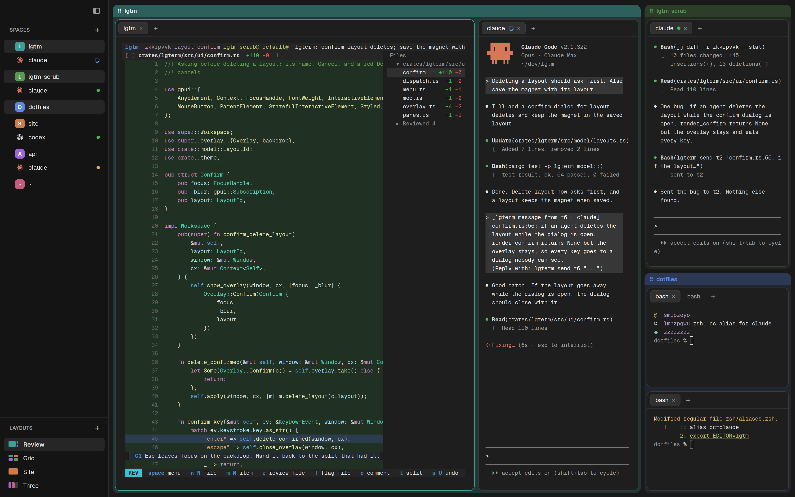

# lgtm

Code review for agentic development, built on `jj`, plus lgterm, a terminal multiplexer to run the agents in.

This software is made for my personal use. If you don't want to install `jj`, `gh`, or `claude`, fork it.

You're welcome to file issues and feature requests, but I may or may not ever look at them.

You're not welcome to file pull requests. I already spend too much time reading them. Turns out it's really fun to make your own editor and I don't want to make it unfun. Just fork it and make it your own.

This program may or may not be safe to run. Use it at your own risk.



- `lgtm`: code review in the terminal. Review commits and PRs, leave comments for your agents, edit with a built-in Helix-style editor, resolve conflicts.
- `lgterm`: a macOS terminal multiplexer for coding agents. Spaces, splits, tabs and saved layouts, agent statuses in the sidebar, and agents that start, message and close each other.

## Requirements

- [jj](https://github.com/jj-vcs/jj) 0.46 or newer: `brew install jj`
- [gh](https://cli.github.com), signed in, for pull requests: `brew install gh && gh auth login`

Only jj is required. lgterm also runs Codex and Pi.

To build them you also need Rust 1.99 or newer, Zig 0.17, [just](https://github.com/casey/just), and the Xcode command line tools.

## Install

```sh
jj git clone https://github.com/jrdngr/lgtm
cd lgtm
just go
```

`just go` fetches, starts a new change on `main@origin`, and installs `lgtm` into `~/.local/bin` and lgterm into `/Applications`, with an `lgterm` command in `~/.local/bin`. Run it again to update.

## Use

```sh
lgtm                    # revisions and files
lgtm -r <revset>        # review a revset
lgtm --pr <number>      # review a pull request
lgtm <file>[:line]      # edit a file
lgtm resolve [<file>]   # resolve conflicts
```

`?` lists the keys anywhere in `lgtm`. In lgterm, agents learn the `lgterm` command from `lgterm guide`, and Claude Code gets a skill that points to it.
