# lgtm

Desktop code review for agentic development, built on `jj`.

This software is made for my personal use. If you don't want to install `jj`, `gh`, or `claude`, fork it.

You're welcome to file issues and feature requests, but I may or may not ever look at them. 

You're not welcome to file pull requests. I already spend too much time reading them. Turns out it's really fun to make your own editor and I don't want to make it unfun. Just fork it and make it your own.

This program may or may not be safe to run. Use it at your own risk.

## Screenshots

**Do jj stuff**

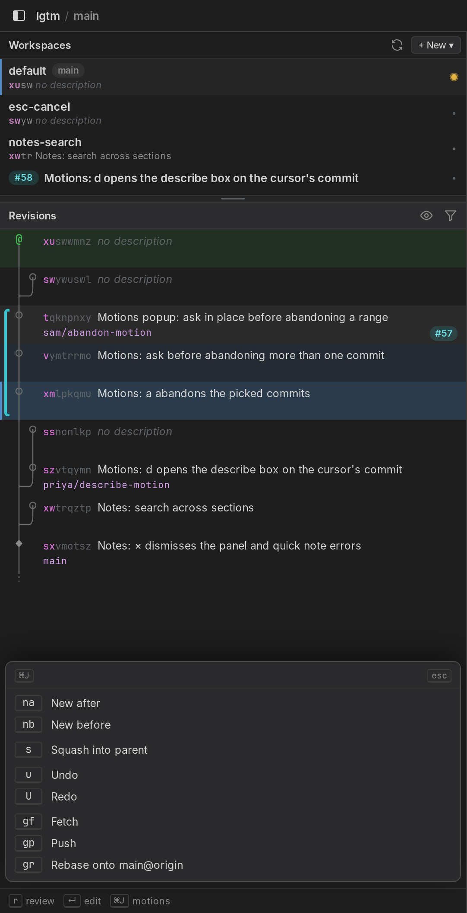

**Ask your agent why it did something stupid**

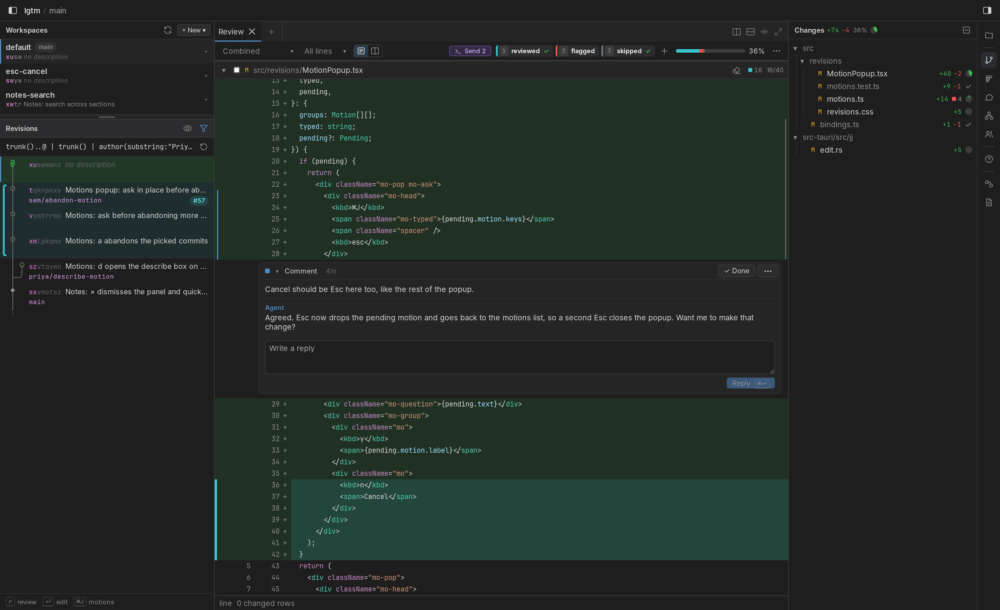

**Custom review marks to help manage your 5000 line diff**

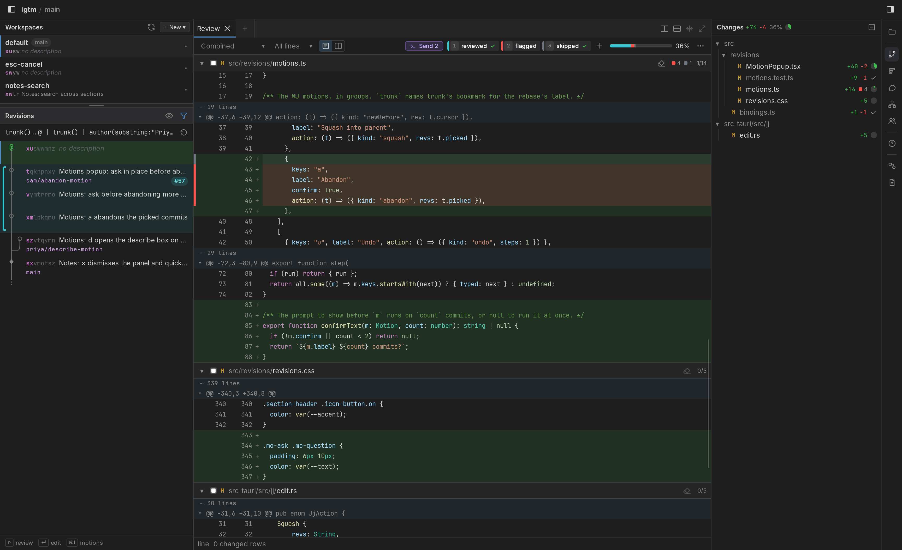

**Guided reviews that contextualize related parts of a diff**

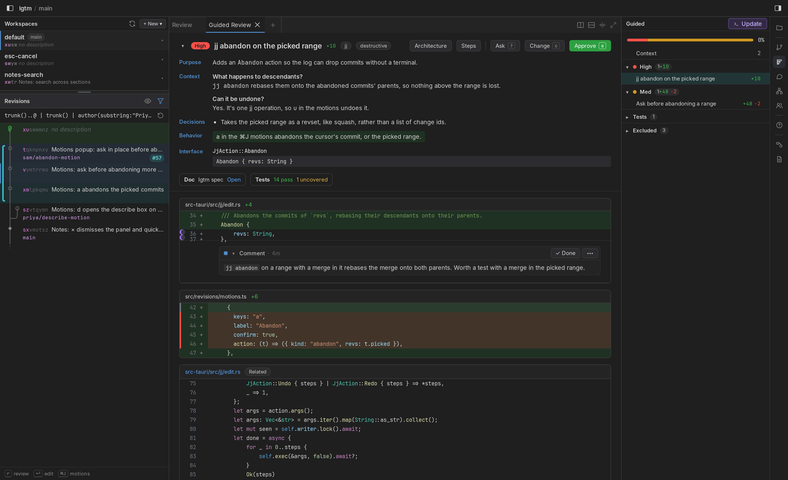

**Ask your agent to help you reply to PR comments about code you didn't write**

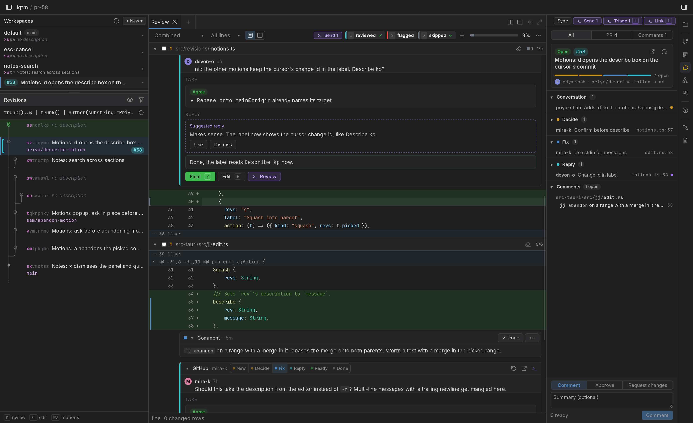

**C4-style architecture diagrams generated from your code, labeled by your diffs**

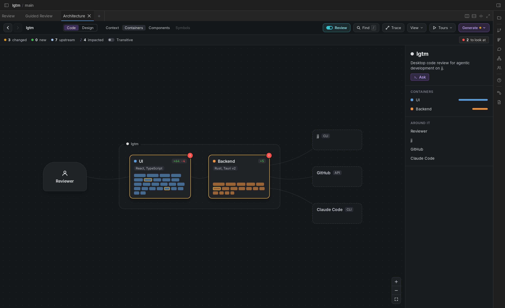

**Arrange your spaghetti nicely**

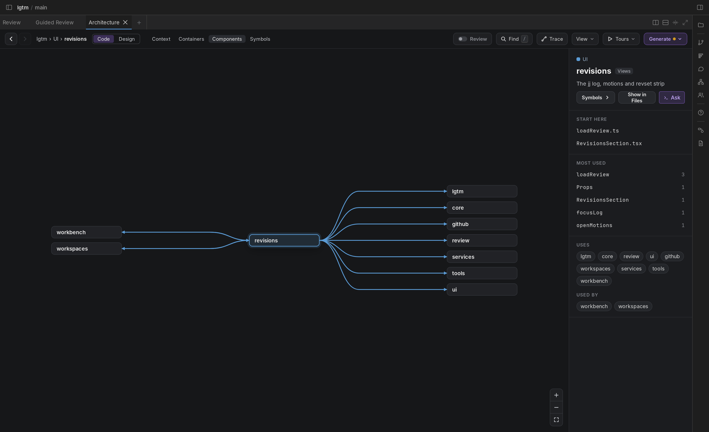

**See your spaghetti in its full glory**

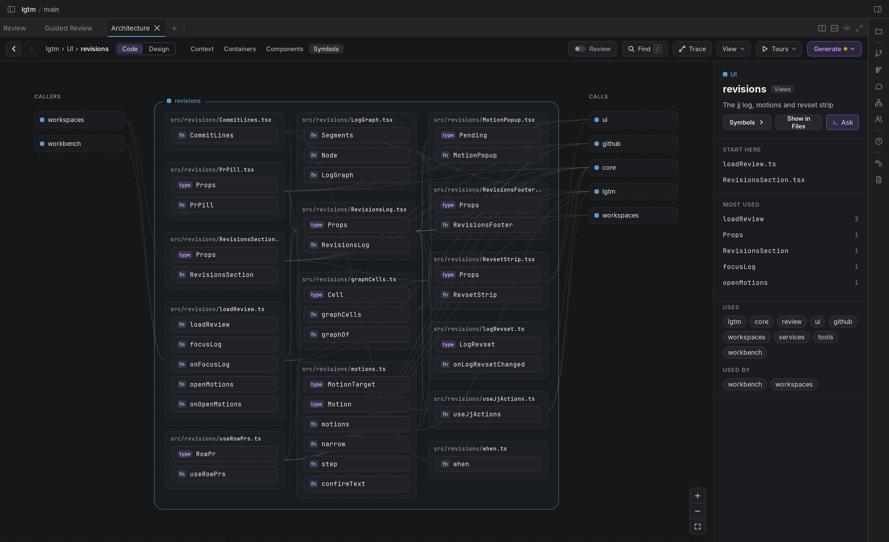

**Draw stuff and tag it so your agent can reference it by number**

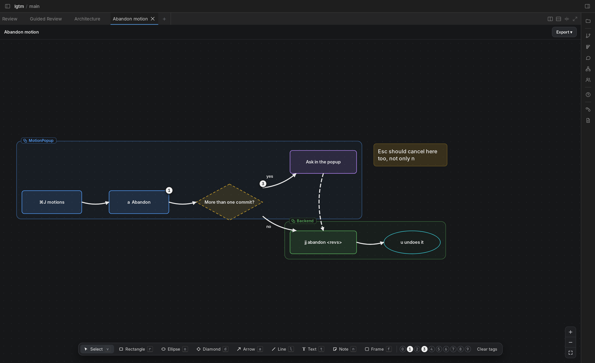

**Q&A with your agent**

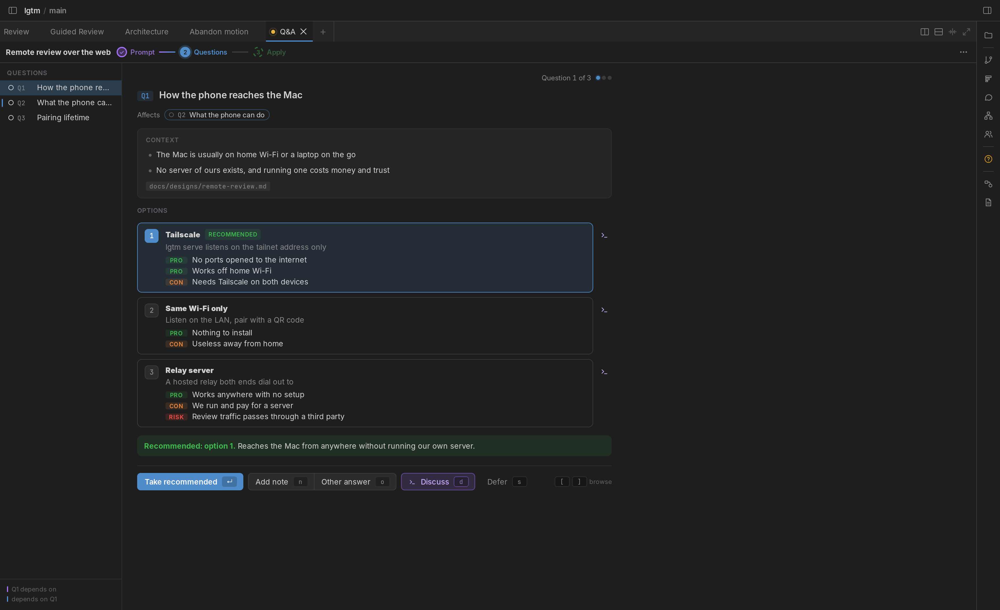

**Code review reports that you won't read because it's easier to type "fix all"**

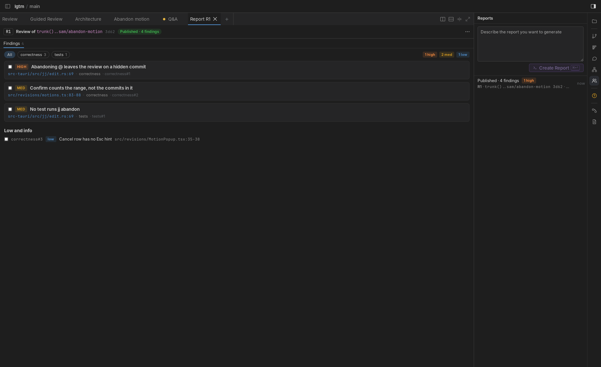

**Notes like Obsidian except you have no idea where the files are**

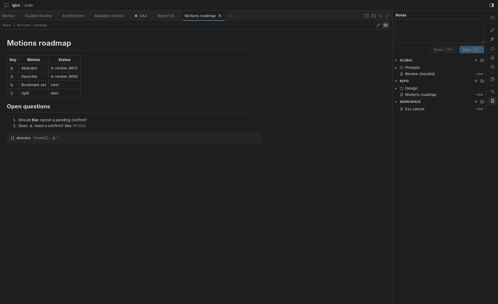

## Requirements

- [jj](https://github.com/jj-vcs/jj) 0.46 or newer: `brew install jj`
- [Claude Code](https://claude.com/claude-code), for the agents: `curl -fsSL https://claude.ai/install.sh | bash`
- [gh](https://cli.github.com), signed in, for pull requests: `brew install gh && gh auth login`

lgtm checks for these at startup and says what's missing. Only jj is required.

To build it you also need Rust, Node 22, pnpm, [just](https://github.com/casey/just), and the Xcode command line tools.

## Install

```sh
git clone https://github.com/jrdngr/lgtm
cd lgtm
pnpm install
just install     # release build, copied to /Applications
```

## Develop

```sh
pnpm install
just dev         # hot reload; shows the repo picker
just go          # jj git fetch, jj new main@origin, then just dev
just test        # tsc + biome, vitest, cargo test (the Rust tests run jj)
just log=debug dev   # dev with debug logging; logs also go to logs/
just install     # release build, copied to /Applications
```
