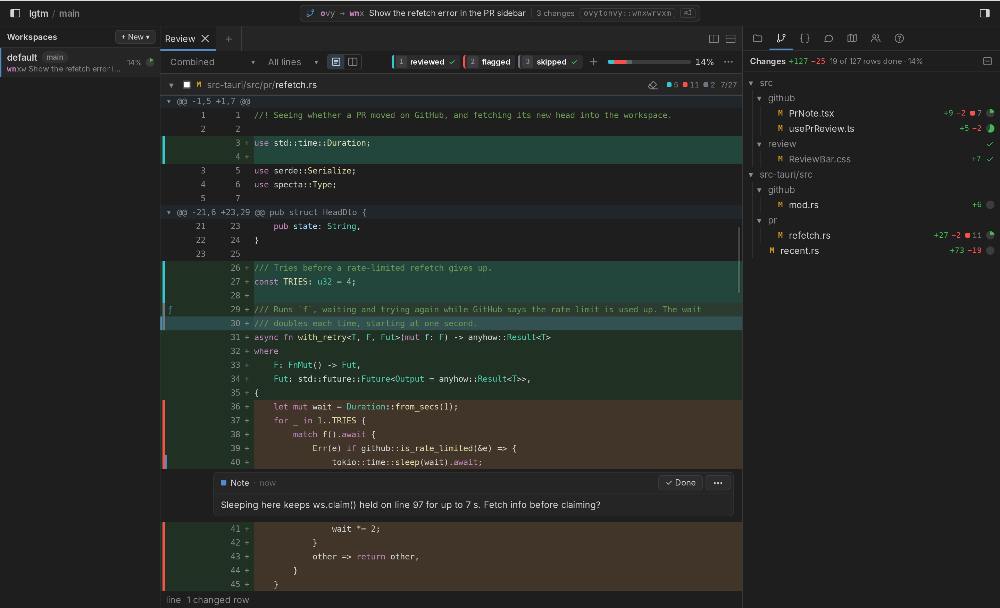
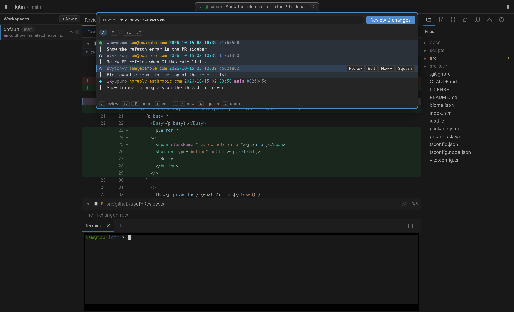
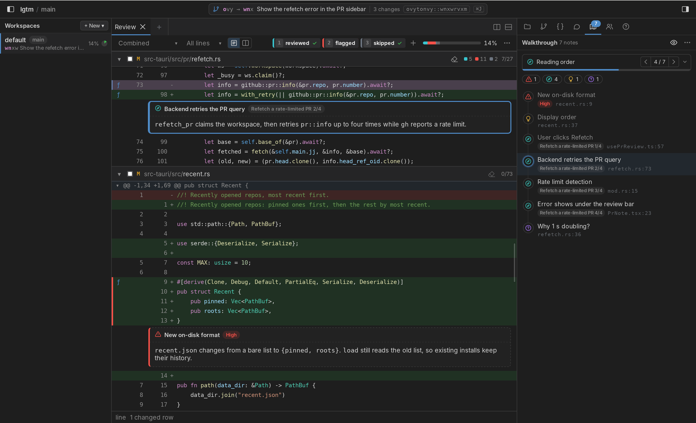
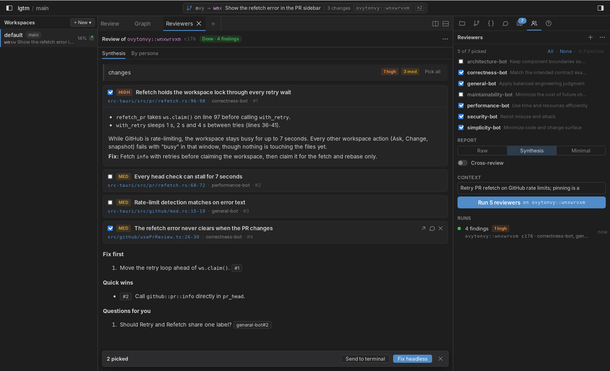
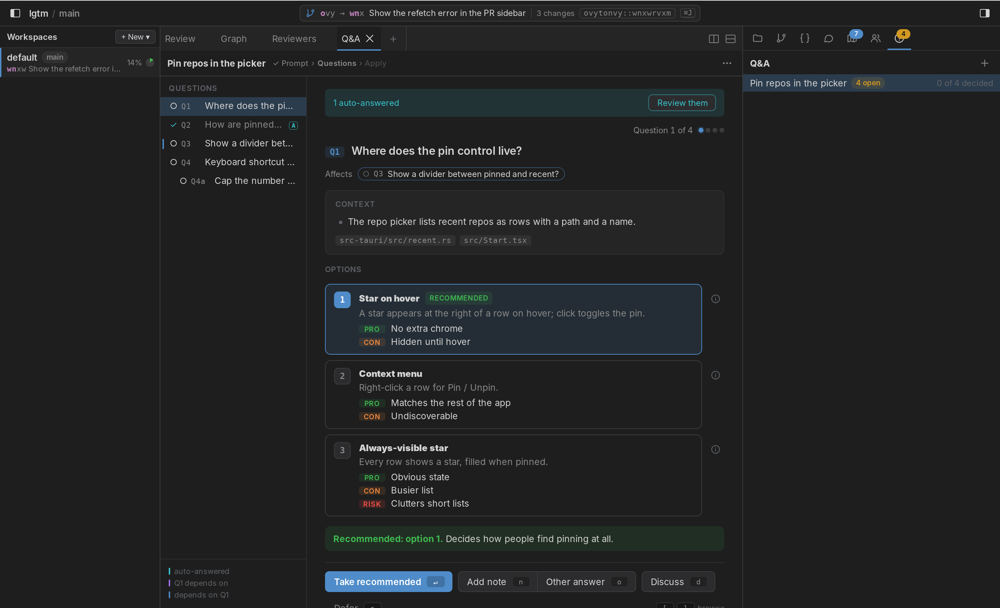
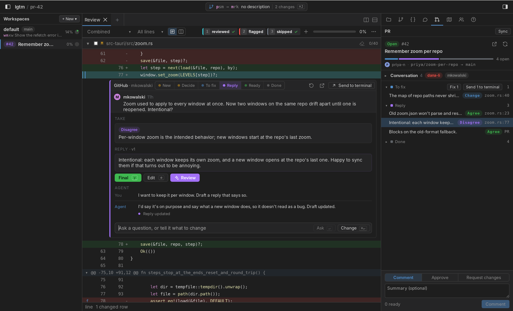
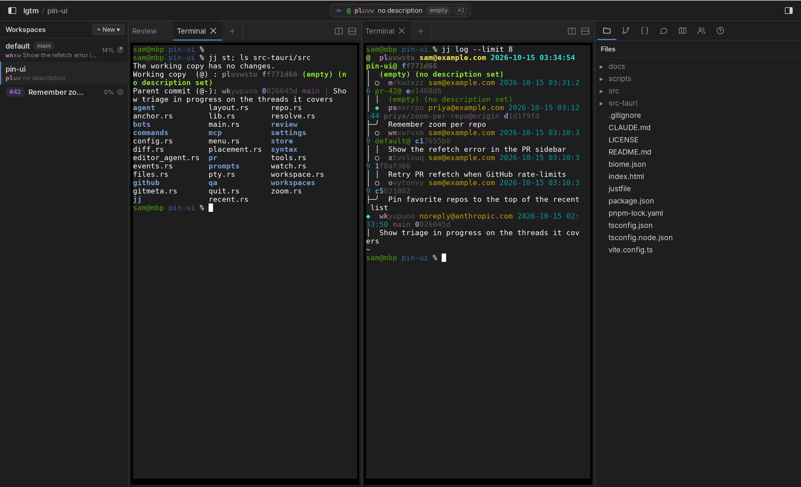

# lgtm

Desktop code review for agentic development, built on `jj`.

This software is made for my personal use. If you don't want to install `jj`, `gh`, or `claude`, fork it.

You're welcome to file issues and feature requests, but I may or may not ever look at them. 

You're not welcome to file pull requests. I already spend too much time reading them. Turns out it's really fun to make your own editor and I don't want to make it unfun. Just fork it and make it your own.

This program may or may not be safe to run. Use it at your own risk.

## Screenshots

**Mark reviewed lines with customizable colored labels**



**jj stuff**



**Explain this PR**



**Agentic code review reports**



**Structured Q&A**



**Ask your agent to help you reply to PR comments about code you didn't write**



**jj workspaces with their own terminals and layout**



Right-click a workspace to pin it to the top of the list or give it a color. Drag pinned workspaces to reorder them. The PR button in the Workspaces header shows or hides the stack's PR list; hiding it clears the selected PRs.

Everything sent to a terminal (⌘>, violet buttons, Send Path to Terminal) goes to the send target: the last terminal you focused, whose tab title is violet. Click the ›_ before the focused terminal tab's title (or pick Pin as Send Target from its menu) to keep sends going there; it turns violet while pinned. Rename on a terminal tab's menu edits its title in place. Violet buttons also press Enter when an agent runs in the target, so it starts right away; ⌘> and Send Path only paste.

## Requirements

- [jj](https://github.com/jj-vcs/jj) 0.46 or newer: `brew install jj`
- [Claude Code](https://claude.com/claude-code), for the agents: `curl -fsSL https://claude.ai/install.sh | bash`
- [gh](https://cli.github.com), signed in, for pull requests: `brew install gh && gh auth login`

lgtm checks for these at startup and says what's missing. Only jj is required.

To build it you also need Rust, Node 22, pnpm, [just](https://github.com/casey/just), and the Xcode command line tools.

## Install

Download the .dmg from [Releases](https://github.com/jrdngr/lgtm/releases) and drag lgtm to Applications. Or build it:

```sh
git clone https://github.com/jrdngr/lgtm
cd lgtm
pnpm install
just install     # release build, copied to /Applications
```

The app's binary takes a repo path: `lgtm /path/to/repo`. Launched without one, it reopens the last repo, or shows the repo picker when that's gone. A second launch for the same repo focuses its window. Plain git repos get an offer to set up jj alongside git.

On first run, lgtm offers to register itself as an MCP server with Claude Code, so `claude` in an lgtm terminal can read and comment on the open review, write its walkthrough (Walkthrough, `h`, sends the prompt), and sync a PR's threads (stage, take and reply) with a review-reply workflow run in the terminal. Each write names the review's revset, or a thread's PR, and lgtm refuses it once the review has moved to another revset or to commits it hasn't loaded, or the workspace's PR has moved on. Link in the PR panel (`l`) links the send target's agent to the whole PR review: it gets a short brief with your reply rules, and the panel shows the linked terminal, a dot while its agent works, and Unlink. The thread you last picked (a row in the PR panel, or anywhere in a thread in the review) is the one you're on: it shows a violet terminal mark, and the hook adds it to each prompt you send there, whole the first time and by name after. Talk (the ›_ button in a thread's header, or ⌘>) picks the thread and focuses the linked terminal, linking one first if none is. The agent can set takes, move threads and suggest replies on any thread, but only you mark a reply ready; a suggestion shows under the reply with Use and Dismiss and a violet dot on its row, and a reply it gives a thread that already has one comes as a suggestion. Each exchange is filed under the thread you were on when you sent it, in the thread's folded Chat row (Show Chat in a row's menu opens it). Linking another terminal, Unlink, closing the terminal or ending its session drops the link, and the old agent hears so on its next prompt. Review next to a reply's Edit sends the thread, the reply and your reply rules to the linked terminal (or the send target), and the agent suggests a better reply. On a new, untriaged thread, Triage there sends it with your reply rules, and the agent sets its take and first reply; Triage N in the PR panel sends every new thread to the linked terminal, or the send target when none is linked. Questions it asks (like a qqueue session) open in the Q&A tab, talking one over in the terminal can rewrite it there, and Answers sends your answers back to the terminal that asked. That agent also runs the tab's steps: after an answer that others depend on, Discuss and ⓘ on an option, and asking a question again after a discussion each paste a short prompt there and press Enter, waiting while the agent is busy. A discussion reply lands in the question's card when the agent finishes. If that agent is gone, the send target's agent takes the session over. Start Q&A sends a session you write in lgtm (its prompt, plus any Read first files dropped from the Files tree or Finder, or picked with Add) to the send target, and its questions come back the same way. Assess in the Architecture sidebar sends the review's architecture diff to the send target, and the agent hands back a score, risk, layers and items to look at, replacing the last assessment of that revset in that workspace. Once the revset moves to other commits, the assessment shows as Stale. Fix on picked intents, or in an intent's or a Wrong edge's detail, sends them to the send target for the agent to change the code. The System tab (New Tab › System) maps the workspace's whole system from its imports, as C4 context, containers and components (double-click to drill in, Backspace to go back), drawing the selection's edges or the heaviest ones. Describe there sends the map to the send target, and the agent hands back names, descriptions, people, external systems and the tiers components sit in; components changed since show as stale. Change marks what the current review changes. ⌘-click a link in markdown (editor or rendered) to open it: web addresses in the browser, repo paths in an editor tab. It also adds Claude Code hooks to `~/.claude/settings.json` (they do nothing outside lgtm), so each workspace in the sidebar shows its most urgent agent: needs input, failed, stalled (no output for 3 minutes), working, done, idle, or none. Hovering that mark lists each agent with how long it's been in its state, and clicking one brings up its tab. A tab running an agent shows the same mark before its title. A terminal tab takes its title from Claude Code's session unless you rename it, and a Claude Code session still open when lgtm closes resumes (the Claude command with `--resume`) in its terminal when lgtm opens again. Any agent can publish review findings to a report, with its own suggested fixes if it has them, and checked findings or fixes go back to a terminal: the Reports panel keeps the report you describe, and Create Report sends it with instructions to publish here. Each report has an id (`R12`, or a name you give it with Rename…) that you tell the agent, and publishing again under the same reviewer name replaces that reviewer's findings.

## Commands

```sh
lgtm [repo]               # open a repo, or the repo picker
lgtm gc [--force] [repo]  # remove leftover workspace directories, forget workspaces whose directory is gone
                          # (workspaces whose repo can't be found are kept unless --force)
lgtm mcp                  # the MCP server Claude Code starts; you don't run it yourself
```

## Develop

```sh
pnpm install
just dev         # hot reload; shows the repo picker
just go          # jj git fetch, jj new main@origin, then just dev
just test        # tsc + biome, vitest, cargo test (the Rust tests run jj)
just build       # release binary and .app
just install     # just build, then copy the .app to /Applications
just run [repo]  # run the built .app (with its Dock icon)
just gc [repo]   # lgtm gc with the release build
just bump 0.2.0  # set the app version before a release
```

To release: `just bump <version>`, push, then run the Release workflow in GitHub Actions. It builds a signed, notarized universal .dmg into a draft release to publish.

Debug builds regenerate `src/bindings.ts` from the Rust commands. `cargo test` fails if it's stale; rerun with `UPDATE_BINDINGS=1` to refresh it.

## Config

App settings are in `~/.config/lgtm/settings.toml` (lgtm › Settings…, ⌘,). The Claude command (an alias like `cc` works, since the terminal's shell runs it) starts Claude Code in a new Claude tab (New Tab › Claude) and resumes sessions. lgtm also runs it to check Claude Code's version and register its MCP server. Prompt overrides go in `~/.config/lgtm/`.

Optional, in the repo at `.lgtm/config.toml`. lgtm reads it from the review's base, so the changes under review can't change it:

```toml
# Files to skip: they start collapsed and count as done.
skip = ["*.lock", "**/generated/**"]

[anchor]
window = 2       # context lines above and below a marked line
threshold = 0.5  # minimum context score for a duplicate line to match
```

An executable `.lgtm/setup` runs in the first terminal of each new workspace. lgtm asks before running it the first time, and again whenever it changes; Skip opens a plain shell. It never runs for a pull request's workspace.
